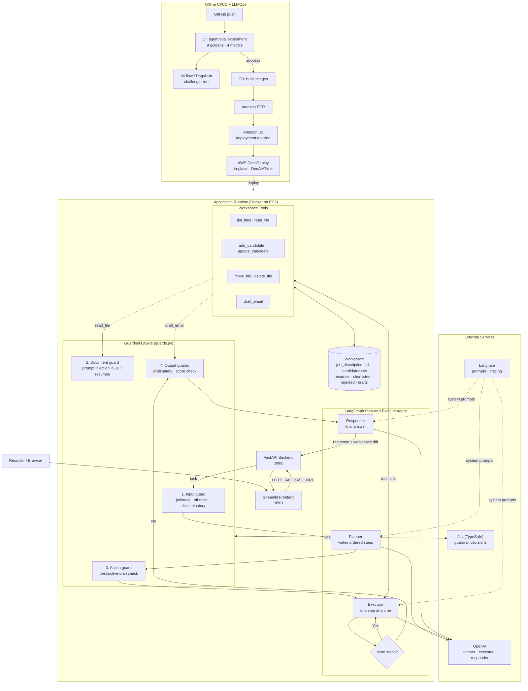

# 🚀 RecruitIQ — Agentic Hiring Assistant with Guardrails and LLMOps

### Plan-and-execute resume screening agent with layered guardrails, automated evaluation, and a containerized AWS deployment pipeline


---

## 📖 What is RecruitIQ?

**RecruitIQ** is an AI agent that works on a hiring workspace the way a recruiting coordinator would. A recruiter types a task in plain English, for example *"Screen Dev Malhotra's resume, add him to the tracker, move his resume to shortlisted or rejected, and draft an interview invite if he is shortlisted"*. The agent plans the work, executes it step by step with real tools, and reports what it did.

```
LangGraph Plan-and-Execute  ·  Tool-Using Executor  ·  Rule-Based Scoring From the Job Description
Langfuse Versioned Prompts  ·  Layered Guardrails  ·  DeepEval Agent Metrics
```

---

## 🧠 System Architecture

The diagram separates three concerns: the **application runtime**, **external services**, and the **offline CI/CD and evaluation pipeline**.



**Reading the diagram**
- Solid arrows are request and data paths. Dotted arrows are indirect links: guard checks on specific tools, prompt loading, and deployment.
- **Planner:** receives the task plus a snapshot of the workspace (file paths and tracker rows) and returns an ordered list of concrete steps. It never sees file contents.
- **Executor:** a tool-using sub-agent that runs **one step per visit**. It only sees the completed steps and the current step, never the full task or the rest of the plan.
- **Responder:** turns the step results into the final reply.
- **Single-turn:** there is no checkpointer. Every task is an independent run, and nothing carries over between tasks.
- **API response:** besides the answer, `/agent/run` returns a before/after diff of the workspace (added, moved and deleted files, new tracker rows), so the UI can show exactly what changed.

---

## 🔧 Key Features

### 1. 🤖 Plan-and-Execute Agent — ✅ Implemented

| Node | Model (from `params.yaml`) | Responsibility |
|---|---|---|
| Planner | `gpt-4o-mini` | Structured output (`Plan`): ordered, concrete steps using only filenames in the workspace snapshot |
| Executor | `gpt-4.1-mini`, temperature 0 | Runs one step with a model ↔ tools loop |
| Responder | `gpt-4.1-mini`, temperature 0 | Writes the final answer from the step results |

The executor cannot loop, so for tasks like *"screen every resume"* the planner writes one explicit step per file. Conditional tasks (*"add everyone with Spark experience"*) become conditional steps: read every resume, then add only the matches.

### 2. 🛠️ Workspace Tools — ✅ Implemented

| Tool | What it does | Safety behavior |
|---|---|---|
| `list_files` | List files and subfolders in one folder | Read-only |
| `read_file` | Read one resume, the JD, or the tracker | Read-only |
| `add_candidate` | Add one row to `candidates.csv` | Refuses a name already in the tracker |
| `update_candidate` | Change one field of an existing row | Cannot change `candidate_id`, add or delete rows |
| `move_file` | Move a resume to `shortlisted/` or `rejected/` | Never overwrites, never creates folders |
| `delete_file` | Delete one file | Never deletes folders, capped at 2 per run |
| `draft_email` | Save a draft to `drafts/` | **Never sends**, refuses an empty recipient |

All file access goes through one workspace service layer that resolves paths safely, so tools cannot reach outside the workspace.

### 3. 📋 Rule-Based Screening — ✅ Implemented

Scoring comes from the job description, not from the model's opinion. The sample role is **Junior ML Engineer**:

| Rule | Detail |
|---|---|
| **Must-have** (all required) | Python, SQL, an ML framework (scikit-learn / PyTorch / TensorFlow), Git, at least 2 years of experience |
| **Nice-to-have** (1 point each) | AWS, Docker, LangChain, MLflow, Spark, Kubernetes |
| **Shortlisted** | Meets every must-have, fit score = nice-to-haves matched (0–6) |
| **Rejected** | Missing any must-have, fit score 0 |
| **Fairness rule** | Screen only on skills and experience listed in the JD |

The 15 sample resumes include deliberate traps: marital status and age written on a resume, a candidate with no email, and duplicate resumes (`rohan_mehta.txt` and `rohan_mehta_resume_final.txt`).

### 4. 🔒 Four-Layer Guardrails — ✅ Implemented

Guard decisions are made by **Jev (TypeSafe)**, which answers yes/no questions as probabilities, and enforced through **Guardrails AI** validators with explicit thresholds.

| Layer | What it checks | Threshold |
|---|---|---|
| **1. Input** | Jailbreak or role-play attempts, off-topic requests, screening by personal attributes (age, gender, caste, nationality, etc.) | 0.8 / 0.3 / 0.7 |
| **2. Documents** | Prompt injection hidden in resumes or the JD (text aimed at the AI, or orders to score, move, delete or email) | 0.7 |
| **3. Actions** | The plan before it runs: more than 2 certain deletes, or deleting a protected file | 0.7 |
| **4. Outputs** | Email drafts mentioning personal attributes or extra contact details, and tracker `fit_score` re-checked against the JD | 0.7 |

**Design choices**
- **Fail-closed:** if the guard service errors, the request is *not* treated as safe. A failed call is an error, never a "no".
- **Uniform block message:** users always see `"This request cannot be processed. Please try again."` The real reason goes to the log, so an attacker cannot tell which check caught them.
- **Two-stage delete limit:** the plan is checked before it runs, and a runtime counter in `delete_file` caps conditional deletes too.
- **Score check without LLM arithmetic:** an LLM reads the JD and the resume and lists points per criterion, then **must call a `calculate_score` tool**, and Python does the sum. The LLM reads, code adds.

**Known limitations**
- The guard layers, validators and `DeleteLimit` are implemented in `guards.py`, but the `agent.py` in this repo does not yet call them from the graph. Wiring them in as graph nodes is 🔭 planned.
- Guards depend on an external service (Jev), which adds latency and a failure point.

### 5. 📝 Versioned Prompts — ✅ Implemented

The planner, executor and responder system prompts live in **Langfuse**, loaded with the `latest` label when the agent is built. A prompt change takes effect without redeploying code (Langfuse caches prompts for about 60 seconds). Each experiment run records the prompt versions it used, so results can be tied to exact prompt text.

### 6. 📊 Agent Evaluation — ✅ Implemented

DeepEval scores the agent offline on a golden set of **9 tasks** (3 easy, 3 medium, 3 difficult). Each golden lists the tool calls the agent is expected to make.

| Metric | Type | What it measures |
|---|---|---|
| **Task Completion** | DeepEval, LLM judge | Did the agent accomplish the task? |
| **Plan Quality** | Custom LLM judge | Is the plan sound given the workspace? |
| **Plan Adherence** | Custom LLM judge | Did the executor follow the plan? |
| **Tool Correctness** | Deterministic, exact match | Same tools, same order, same arguments |

**Latest report** — 07 Nov 2026 (`eval_results/reports/agent_eval_20261107_1754.md`). Judge model `gpt-5.4-mini`, pass threshold 0.7, prompts at Langfuse v1.

| Metric | Average score | Passed |
|---|---|---|
| Task Completion | **0.85** | 7/9 |
| Plan Quality | **0.76** | 6/9 |
| Plan Adherence | **0.83** | 7/9 |
| Tool Correctness | **0.22** | 2/9 |

**Pass rate by difficulty**

| Difficulty | Task Completion | Plan Quality | Plan Adherence | Tool Correctness |
|---|---|---|---|---|
| Easy (3) | 3/3 | 3/3 | 3/3 | 2/3 |
| Medium (3) | 3/3 | 2/3 | 3/3 | 0/3 |
| Difficult (3) | 1/3 | 1/3 | 1/3 | 0/3 |

Tool Correctness is intentionally strict: a single differing argument scores 0, so it sits well below the judge-based metrics. The weakest area is the **difficult bulk tasks** (for example, finding every candidate with Spark experience and processing each one).

**Experiment tracking:** `execute_experiment_pipeline.py` runs the evaluation and logs parameters (from `params.yaml`), prompt versions and texts, metrics, code files, and traces as an MLflow run on **DagsHub**, tagged as a challenger.

```bash
uv run python -m hiring_agent.experimentation.execute_experiment_pipeline
uv run python -m hiring_agent.experimentation.execute_experiment_pipeline --only 1 2 3   # specific goldens
```

These scores are offline results on a small 9-task set. They show how the agent behaves on known scenarios, not general production accuracy.

### 7. 🖥️ Web UI and API — ✅ Implemented

The Streamlit app talks to the backend only over HTTP. It shows KPI cards for resumes, shortlisted, rejected and drafts, a resume previewer, the tracker table, and the agent panel.

| Method | Endpoint | Description |
|---|---|---|
| `POST` | `/agent/run` | Run the agent on a task, return the response and a workspace diff |
| `GET` | `/workspace` | File tree and tracker rows |
| `GET` | `/workspace/file?path=...` | Text of one file |
| `POST` | `/workspace/upload` | Upload a job description and resumes |
| `GET` | `/health` | Checks that OpenAI and Jev both answer (never fails itself) |

The API serves its own `workspace_app/` directory, so uploads never touch the seeded `workspace/` that the CLI and evals use.

---

## 🧩 Key Architecture Decisions

| Decision | Why it was chosen | Trade-off |
|---|---|---|
| **Plan-and-execute over a single ReAct loop** | The plan is explicit, so it can be judged, guarded before it runs, and compared with what the executor did | A bad plan sinks the whole run, and long plans use many executor visits |
| **Executor sees only one step** | Keeps context small and prevents a step from acting on the wider task | Needs complete step wording and carried-over results |
| **Separate planner model** | A cheap model is enough to write a plan | Planner quality limits bulk-task success |
| **Prompts in Langfuse** | Prompt changes without a redeploy, with versions recorded per experiment | Extra service and a short cache delay |
| **Guard decisions from Jev, math in code** | Probabilities are tunable per layer, and arithmetic is never left to an LLM | External dependency and added latency |
| **Fail-closed guards** | A guard that passes when its service is down is not a guard | A guard outage blocks legitimate requests |
| **Drafts only, never send** | Keeps a human in the loop for outbound email | Recruiter must send manually |
| **Exact-match Tool Correctness** | Deterministic and cheap, with no judge noise | Very strict; some correct alternatives still score 0 |

---

## ☁️ Deployment

The API and the frontend ship as two Docker images (`docker/Dockerfile.api`, `docker/Dockerfile.frontend`) and run side by side with Docker Compose on EC2 in `ap-south-1`.

### CI/CD pipeline

```
GitHub push to main
   ↓
CI Pipeline  → install dependencies, run the agent evaluation experiment
               (logs a challenger run to MLflow on DagsHub)
   ↓ (on success, or manual dispatch)
CD Pipeline
  Job 1: build-and-push → build API + frontend images, push to Amazon ECR
                          (tagged with the commit SHA and `latest`)
  Job 2: deploy         → zip appspec + compose + hook scripts, upload to S3,
                          start an AWS CodeDeploy deployment
```

| Component | Status |
|---|---|
| Dockerfiles for API and frontend | ✅ Implemented |
| ECR build and push with commit-SHA tags | ✅ Implemented |
| CodeDeploy in-place, `OneAtATime`, with stop / install / start / validate hooks | ✅ Implemented |
| API `.env` pulled from AWS Secrets Manager on the instance | ✅ Implemented |
| Production tracing (`LANGFUSE_TRACING_ENVIRONMENT=production`) | ✅ Implemented |
| HTTPS, load balancer, auto scaling | 🔭 Planned. Not configured in this repo |

CodeDeploy runs **in-place with `OneAtATime`**, and the repo defines a single instance per service. Zero-downtime rolling deployments are not demonstrated.

---

---

## 🗂️ Project Structure

```
RecruitIQ/
├── src/hiring_agent/
│   ├── app/             # agent graph, tools, guards, prompts, workspace service, LLM clients
│   ├── api/             # FastAPI app + routers (agent, workspace, health)
│   ├── frontend/        # Streamlit UI
│   ├── config/          # params.yaml loader and validation
│   ├── evals/           # DeepEval metrics, custom judges, report generation
│   ├── experimentation/ # eval pipeline → MLflow on DagsHub
│   └── utils/           # helpers, e.g. push_prompts to Langfuse
├── workspace_original/  # pristine seed: JD, 15 sample resumes, empty tracker
├── workspace/           # working copy for the CLI and evals
├── goldens/             # 9 golden tasks with expected tool calls
├── eval_results/        # saved reports (.md / .csv) and traces
├── docker/              # Dockerfile.api, Dockerfile.frontend
├── deploy/codedeploy/   # appspec, docker-compose, hook scripts
├── .github/workflows/   # ci.yaml, cd.yaml
├── params.yaml          # model and agent settings
└── pyproject.toml
```

---

## 🚀 Local Setup

```bash
git clone https://github.com/akashagalaveaaa1/RecruitIQ
cd RecruitIQ

uv sync                    # Python 3.11+

# create .env with your own keys (see table below); never commit .env

uv run python -m hiring_agent.utils.push_prompts          # one-time: push prompts to Langfuse

uv run uvicorn hiring_agent.api.main:app --reload         # Terminal 1 (docs at :8000/docs)
uv run streamlit run src/hiring_agent/frontend/agent_app.py   # Terminal 2 (UI at :8501)
```

Upload a job description and resumes in the sidebar, then type a task.

### Docker

```bash
docker build -f docker/Dockerfile.api -t recruitiq-api .
docker build -f docker/Dockerfile.frontend -t recruitiq-frontend .

docker run -p 8000:8000 --env-file .env recruitiq-api
docker run -p 8501:8501 -e API_BASE_URL=http://host.docker.internal:8000 recruitiq-frontend
```

### Try these tasks

```
What are the must-have skills for the Junior ML Engineer role?
Screen Ananya Rao's resume and add her to the tracker
Move vikram_singh.txt to the rejected folder
Find and delete any duplicate resumes
Screen Vikram Singh and Karan Shah, add both to the tracker, move each resume,
and draft an interview invite for each shortlisted candidate who has an email
```

---

## 🔑 Environment Variables

| Variable | Required | Description |
|---|---|---|
| `OPENAI_API_KEY` | ✅ | Planner, executor, responder, score checker and health check |
| `TYPESAFE_API_KEY` | ✅ | Jev guardrail decisions |
| `LANGFUSE_PUBLIC_KEY` / `LANGFUSE_SECRET_KEY` | ✅ | Prompt management and tracing |
| `LANGFUSE_BASE_URL` | ✅ | Langfuse host |
| `LANGFUSE_TRACING_ENABLED` | Optional | Off by default; on in the deployed API |
| `API_BASE_URL` | Frontend | FastAPI endpoint the Streamlit app calls |
| `DAGSHUB_USER_TOKEN` | Optional | MLflow experiment tracking on DagsHub |

**GitHub Actions secrets:** `OPENAI_API_KEY`, `DAGSHUB_USER_TOKEN`, `LANGFUSE_PUBLIC_KEY`, `LANGFUSE_SECRET_KEY`, `AWS_ACCESS_KEY_ID`, `AWS_SECRET_ACCESS_KEY`. **Variable:** `LANGFUSE_BASE_URL`.

---

## 🧰 Tech Stack

| Category | Technology |
|---|---|
| Agent Orchestration | LangGraph StateGraph: planner → executor loop → responder |
| LLM Integration | LangChain + OpenAI (GPT-4o-mini planner, GPT-4.1-mini executor and responder) |
| Tools | 7 workspace tools with path-safe file access |
| Prompt Management | Langfuse, versioned with the `latest` label |
| Security | Guardrails AI validators, Jev (TypeSafe) decisions, LLM + calculator score check |
| Evaluation | DeepEval (Task Completion, Tool Correctness) + two custom LLM judges |
| Experiment Tracking | MLflow on DagsHub |
| Serving | FastAPI with Pydantic schemas |
| Frontend | Streamlit |
| Containerization | Docker, uv |
| Deployment | AWS ECR, S3, CodeDeploy, EC2 with Docker Compose |
| CI/CD | GitHub Actions: CI evaluation → CD build and deploy |

---

## 🔢 Key Numbers

| Metric | Value |
|---|---|
| Task Completion (offline, latest run) | 0.85 |
| Plan Quality / Plan Adherence | 0.76 / 0.83 |
| Tool Correctness (exact match) | 0.22 |
| Golden tasks | 9 (3 easy, 3 medium, 3 difficult) |
| Agent tools | 7 |
| Guardrail layers | 4 |
| Max deletes per run | 2 |
| Sample resumes | 15 |
| Fit score range | 0–6 (nice-to-have skills matched) |
| CI/CD workflows | 2 (CI evaluation, CD build and deploy) |

---

## 👨‍💻 Author

**Akash Agalave**
- GitHub: [@akashagalave](https://github.com/akashagalaveaaa1)
